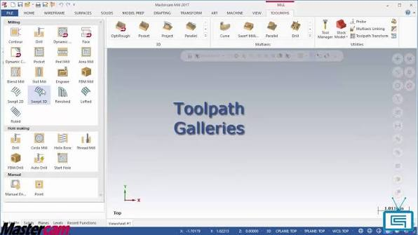
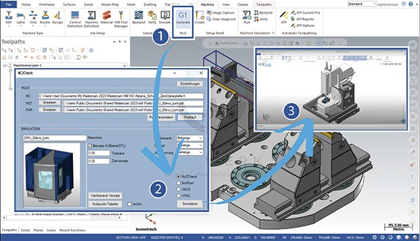

# Mastercam CAD/CAM Software for CNC Programming


## 👁️ About

Mastercam programming brings geometry preparation, machining strategies, simulation, and post processing into a connected manufacturing workflow.

Mastercam software supports CNC milling, turning, Mill-Turn, routing, Swiss machining, and wire EDM through available product configurations.

The application helps programmers prepare operations around the part, material, tooling, workholding, and machine.

Developed by CNC Software, LLC, Mastercam is used in production shops, manufacturing engineering, and technical education.

Search phrases such as master cam, cnc mastercam, and mastercam cad refer to the application and its machining or design workflows.

[](https://github.com/amandabl4661/mastercam-programming/releases)

> [!NOTE]
> This overview covers Mastercam 2026 and the Mastercam 2026.R2 release.
> The accompanying OpenCAMLib collection contains independent CAM reference code.
> Its files illustrate machining concepts and do not represent Mastercam's proprietary source.

## 👨‍🎓 User Guide

Organize each job around a defined part revision and a documented machine setup.

1. Prepare or import the part geometry.
2. Confirm units, orientation, and work coordinates.
3. Define stock and workholding.
4. Select the machine configuration and post processor.
5. Assign tools and holders.
6. Create machining operations.
7. Review tool motion and remaining material.
8. Generate and validate the NC output.

Keep geometry changes, operation changes, and machine configuration changes traceable throughout the job.

## 👌 Features

Capabilities depend on the selected products, licenses, machine configuration, and release.

| Feature | Description | Scope |
| :--- | :--- | :--- |
| CAD Preparation | Create and modify geometry for machining | Design workflow |
| 2D Milling | Prepare profiles, pockets, drilling, and related operations | Mill products |
| 3D Milling | Develop roughing and finishing paths for complex surfaces | Mill 3D products |
| Multiaxis | Control tool orientation during advanced machining | Appropriate licensing |
| Turning | Program operations for rotational components | Lathe products |
| Mill-Turn | Coordinate milling and turning workflows | Supported configurations |
| Routing | Prepare router-oriented machining operations | Router products |
| Wire EDM | Program wire electrical discharge machining | Wire products |
| Dynamic Motion | Apply material-aware toolpath strategies | Supported operations |
| Simulation | Inspect machining motion and material removal | Configuration dependent |
| Post Processing | Produce output for a machine and control | Suitable post required |



## Cutting Tools

Tool selection affects accessibility, engagement, surface finish, and remaining stock.

Review cutter diameter, corner radius, usable length, holder dimensions, and tool reach together.

The independent reference models [ballcutter.hpp](src/cutters/ballcutter.hpp) and [cylcutter.hpp](src/cutters/cylcutter.hpp) illustrate spherical and cylindrical cutter geometry.

Additional shapes appear in [bullcutter.hpp](src/cutters/bullcutter.hpp) and [conecutter.hpp](src/cutters/conecutter.hpp).

These interfaces provide background for understanding cutter contact rather than instructions for configuring a Mastercam tool library.

## Geometry and Coordinates

A consistent coordinate system keeps the part, stock, fixtures, and operations aligned.

Confirm the relationship between model orientation, machining planes, work offsets, and machine travel.

The reference types [point.hpp](src/geo/point.hpp) and [triangle.hpp](src/geo/triangle.hpp) describe basic geometric elements.

[stlsurf.hpp](src/geo/stlsurf.hpp) and [path.hpp](src/geo/path.hpp) provide context for triangulated surfaces and geometric paths.

When transferring geometry, check units and orientation before regenerating operations.

## Toolpath Planning

Separate bulk material removal from operations intended to establish final dimensions and finish.

| Goal | Planning consideration |
| :--- | :--- |
| Roughing | Engagement, tool reach, and stock allowance |
| Surface finishing | Stepover, contact geometry, and accessibility |
| Wall finishing | Deflection, remaining stock, and clearance |
| Drilling | Hole depth, cycle selection, and chip evacuation |
| Rest machining | Material remaining after previous operations |
| Edge finishing | Edge selection and tool orientation |

Reference calculations appear in [pathdropcutter.hpp](src/dropcutter/pathdropcutter.hpp) and [adaptivepathdropcutter.hpp](src/dropcutter/adaptivepathdropcutter.hpp).

[waterline.hpp](src/algo/waterline.hpp) and [adaptivewaterline.hpp](src/algo/adaptivewaterline.hpp) illustrate another family of surface-based algorithms.

Their implementations belong to OpenCAMLib and should be studied using that project's documentation.

## 💻 Post-processors

A post processor translates machining operations into output appropriate for a specific machine and control.

Selection should account for:

- Machine kinematics and axis configuration.
- Supported cycles and control syntax.
- Tool-change conventions.
- Work-offset handling.
- Rotary positioning and limits.
- Shop-specific output requirements.

A controller name alone does not establish compatibility with a particular machine.

Have the post and machine configuration reviewed through the appropriate Mastercam support channel.



## 📒 Files Organisation

The collected files follow the OpenCAMLib source layout.

```text
docs/                    API documentation sources
cmake/                   Package configuration templates
src/
├── algo/                Waterline and related algorithms
├── common/              Shared numerical utilities
├── cutters/             Cutter geometry
├── dropcutter/          Drop-cutter operations
├── geo/                 Points, surfaces, and paths
├── pythonlib/           Python bindings
├── nodejslib/           Native JavaScript bindings
└── npmpackage/          TypeScript package sources
```

The root [CMakeLists.txt](CMakeLists.txt) identifies the reference library's CMake build entry point.

Python packaging is described by [pyproject.toml](pyproject.toml) and [setup.py](setup.py).

The JavaScript package has separate metadata in [package.json](src/npmpackage/package.json).

Preserve these paths when reviewing or publishing the accompanying collection.

## Reference File Review

The following PowerShell command lists cutter headers from the collected source root without executing them.

```powershell
Get-ChildItem -LiteralPath ".\src\cutters" -Filter "*.hpp" |
    Select-Object Name, Length |
    Sort-Object Name
```

A checksum can identify the exact reference file included in a review.

```powershell
Get-FileHash -LiteralPath ".\src\cutters\ballcutter.hpp" `
    -Algorithm SHA256 |
    Select-Object Algorithm, Hash
```

These examples use PowerShell and do not launch Mastercam or calculate machining operations.

## Prerequisites

Use the official system requirements for the intended Mastercam release.

Check the operating system, processor, graphics hardware, memory, storage, licensing, and required machine resources.

OpenCAMLib development dependencies are separate from Mastercam workstation requirements.

The Qt, SCons, V8, and C! build instructions used by other reference projects do not install or build Mastercam.

## Verification

Review geometry, tools, fixtures, coordinates, operation order, and posted output before releasing a job.

Record the machine configuration and post-processor identity alongside the part revision.

Simulation results should be assessed with the actual tooling and setup assumptions used during programming.

Keep an approved copy of the source project and the corresponding NC output.

## Related Search Terms

mastercam programming, mastercam software, master cam, cnc mastercam, mastercam cad, cad, cam, cnc, milling, toolpath, gcode, manufacturing, simulation, geometry, cad-cam
